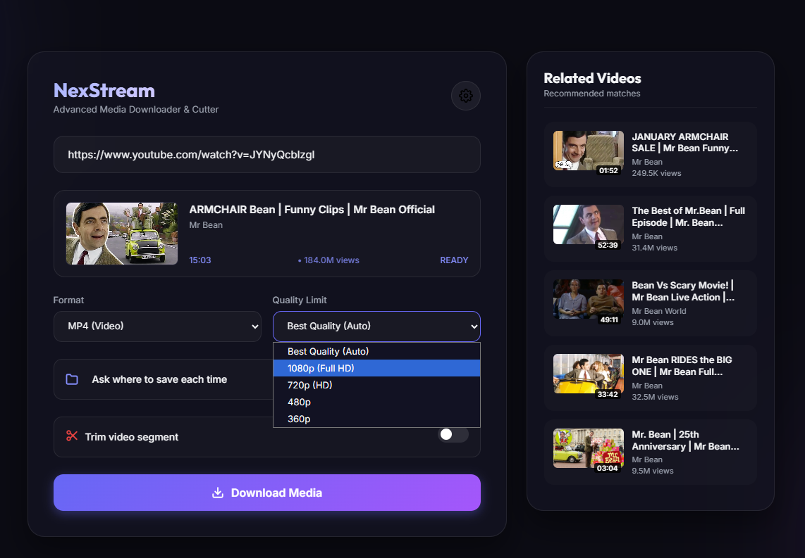

# NexStream - Advanced Video Downloader

NexStream is a modern, production-grade web application designed for downloading online video and audio media (powered by `yt-dlp` and `FFmpeg`). It features a premium, responsive glassmorphic user interface with real-time SSE progress updates, support for multi-language dubbed audio tracks, and custom segment trimming.



---

## Key Features

*   **Multi-Language Dubbed Tracks**: Automatically detects and lets you choose between available audio languages (e.g., Hindi, Spanish, Arabic, Japanese) when downloading.
*   **Media Formats & Quality Limits**: Support for video (MP4) with custom height limits (1080p, 720p, etc.) and audio extraction (MP3).
*   **Precise Segment Trimming**: Trim specific segments of a video during the download process using FFmpeg.
*   **Disk Space Optimization**: Automatically deletes the original heavy untrimmed file after a successful trim cut to conserve local disk space.
*   **SSE Real-Time updates**: Tracks progress in real-time showing percent completion, download speed, ETA, and current sub-status.
*   **Configurable Preferences**: Set global download directories and point to custom FFmpeg paths.

---

## Prerequisites

1.  **Python 3.8+**: Recommended to run inside a virtual environment.
2.  **Node.js**: Required by `yt-dlp` to run JavaScript challenge solvers for YouTube's decryption mechanisms.
3.  **FFmpeg**: Required for merging video and audio streams, extracting audio as MP3, and trimming clips.

---

## Installation & Setup

1.  **Clone the Repository**:
    ```bash
    git clone https://github.com/Mhadasavi/video-downloader.git
    cd video-downloader
    ```

2.  **Set Up Virtual Environment**:
    ```bash
    python -m venv .venv
    .venv\Scripts\activate  # On Windows
    # source .venv/bin/activate  # On macOS/Linux
    ```

3.  **Install Dependencies**:
    ```bash
    pip install Flask yt-dlp yt-dlp-ejs
    ```

---

## Running the Application

You can start the Flask server using the default configuration:
```bash
python app.py
```
This launches the application on `http://127.0.0.1:5000` and automatically opens it in your default web browser.

### Advanced Configuration (Environment Variables)

The application supports configuration via environment variables:

| Variable | Description | Default |
| :--- | :--- | :--- |
| `FLASK_HOST` | Host address to bind the server to | `127.0.0.1` |
| `FLASK_PORT` | Port number to listen on | `5000` |
| `FLASK_DEBUG` | Enables Flask debug mode (`true`/`1`) | `False` |

**Example (Windows Powershell):**
```powershell
$env:FLASK_PORT="5001"
$env:FLASK_HOST="0.0.0.0"
python app.py
```

**Example (Linux / macOS / Bash):**
```bash
FLASK_PORT=5001 FLASK_HOST=0.0.0.0 python app.py
```

---

## Project Structure

```
├── app.py                  # Main Flask application and downloading thread engine
├── templates/
│   └── index.html          # Interactive front-end containing styles and client logic
├── settings.json           # Stores saved user preferences (created automatically)
└── README.md               # Project documentation
```
